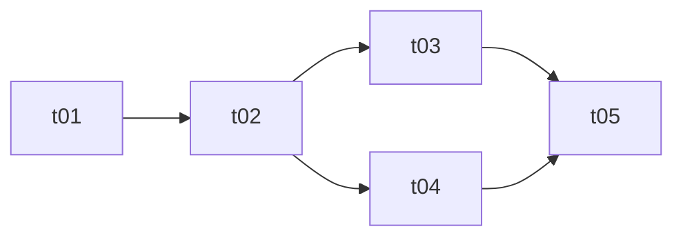

# 拆卡

产出两样东西：**卡片**和**总表**。卡片是一块能验收的工作；总表记录哪些做完了、卡片之间怎么依赖。布局固定，用户和以后的会话都知道去哪找，不要自创变体。

## 0. 先读项目的「任务配置」

本技能是通用的，项目差异全部来自项目根目录 `AGENTS.md` 里的 `## 任务配置` 一节（格式见 `project-init` 技能的模板）。开工先读它，取这些值：

| 配置项 | 用在哪 | 缺省值 |
|---|---|---|
| 卡号前缀 | 卡片文件名、卡号 | `t` |
| 总表 / 卡片目录 | 写到哪 | `docs/TASK.md` / `docs/tasks/` |
| 模块 | 每张卡的「模块」字段 | 不写模块字段 |
| 提交前检查 | 卡片「验收标准」的默认第一条 | 无 |
| 验收红线 | 拆卡时避开、写进相关卡片的「明确不做」 | 无 |
| 子项目（可选） | 多项目仓库：每个子项目自己的前缀、总表、目录 | 无 |

- 没有 `AGENTS.md` 或没有这一节：用缺省值，并告诉用户「可以用 `project-init` 补上任务配置」，不要停下。
- 配置里有「子项目」表时：每张卡只属于一个子项目，卡片和总表写进那个子项目的目录，用它的前缀；确实跨子项目的，用仓库级前缀（表里标明的那一个），或拆成两张卡。
- 下文用 `<前缀>`、`<总表>`、`<卡片目录>` 指代配置值。

```
docs/
├── TASK.md            # <总表>：状态表 + 依赖图
├── tasks/             # <卡片目录>
│   ├── t01-init-project.md
│   └── t02-core-data.md
└── ARCHITECTURE.md    # 有就读
```

## 1. 命名规则

这些细节在会话之间最容易走样，逐字照做：
- 卡片文件：`<前缀>` + **两位、唯一、递增的编号** + `-` + 简短的 kebab-case 英文描述，如 `t01-init-project.md`。
- 描述 2–4 个小写英文单词，说清功能或结果（不用 `misc`、`fix`）。
- 卡片目录用复数 `tasks/`；总表是 `TASK.md`（单数、大写）。
- 编号不复用、不重排：别的卡、依赖图、提交信息都引用它们。新卡用下一个编号。
- 这些文件已存在时，读完再往里加，不覆盖、不改名。
- 卡片正文和总表用用户的语言写（文件名用英文）。

## 2. 前提：用户给了依据

卡片的质量取决于拆的依据，做什么由用户决定，不由你决定。动手前确认用户至少给了一样：
- 要做或要改什么的描述（这条消息里或之前的对话里）；
- 要参考的文档或文件（架构文档的某一节、某个目录、一份需求说明）。

**两样都没有就停下**：不要扫一遍仓库自己猜，不要编需求，不要写占位卡——它们看起来像计划，其实是错的。简短地问：「拆卡需要依据：请告诉我要做什么，或指定要参考的文档 / 章节。」仓库里有明显的候选（`docs/SPEC.md`、`docs/ARCHITECTURE.md` 里的 MVP 范围），点名问用户是不是用它，不要直接默认。

依据太薄、不编出产品核心就拆不下去时（做什么、给谁用、做到什么程度算完），问几个能解开卡点的问题。小缺口（命名、细节范围）可以自己假设，写进卡片的「背景」，让用户能改。

## 3. 流程：新拆一批卡

1. 读用户给的一切，再读 `AGENTS.md`（含任务配置）、`README.md`、`docs/` 下的架构和需求文档、相关代码。这些是对用户输入的补充，不能替代它。
2. 切成卡片。每张卡：
   - 是一块完整、能验收的交付物，一个会话做得完；
   - **尽量独立**：新会话只靠这张卡和仓库里已有的代码就能做完。独立是目标不是规则：有的卡确实建立在别的卡之上，硬拆（重复劳动、假桩）比老实写依赖更糟。依赖是真的就写上；能低成本拆开的（事先约定接口、沿着接缝切），就拆开，好让它们并行；
   - 只依赖编号更小的卡（不成环），只写**直接**依赖，间接的由依赖图推出。
3. 卡片要自给自足：新会话需要的上下文写进卡里，不要假设读者看过这段对话；引用已有文档和文件时写路径。全仓通用的约定不要每张卡都抄一遍，指向 `AGENTS.md` 或架构文档的章节；约定还没写下来的，让第一张卡负责写进去。
4. 写明每张卡的**模块**（配置里有的话）和**触碰文件**。触碰文件是并行时避免撞车的依据：两张可能同时做的卡碰同一个文件，就加依赖、把共用部分挪到更早的卡，或者把约定好的接口同时写进两张卡。特别留意这些「隐形共用」：
   - 两个程序之间的接口（数据库表、消息 / 任务格式、HTTP 接口字段）——先单独一张卡定下来，再并行；
   - 依赖清单和锁文件（`package.json`、`pnpm-lock.yaml` 等）——要装依赖的卡尽量串行，或把装依赖挪到一张前置卡。
5. 写每张卡（模板见下），再写总表。每张卡都要出现在总表里，反之亦然。
6. 收尾时列出所有卡片，以及哪些可以开工（依赖全部完成）。用户没要求就不开始实现；要派出去做，用 `dispatch-task` 技能。

## 4. 卡片模板

卡片要短：长到新会话能开工、知道什么时候算完就够了。没话说的小节可以删，**`明确不做` 除外**：没有就写「无」，这条边界是保证卡片独立的关键。

````markdown
# tNN · <标题>

## 元信息
- 模块：server                     <!-- 配置里没有模块就删掉这行 -->
- 依赖：t01 · t02                  <!-- 直接依赖，没有写「无」 -->
- 触碰文件：`path/a`、`path/b/`     <!-- 本卡新建或修改的文件 -->

## 背景
为什么有这张卡，已经有什么，不再讨论的决定。

## 必读
- `docs/ARCHITECTURE.md` 第 N 节 — 为什么要读
- `path/to/existing/file` — 要照着写的样例

## 范围
- [ ] 具体交付物（文件 / 接口 / 行为）

## 明确不做
- 属于别的卡（tMM）的事，或明确不要的做法

## 验收标准
- 任务配置里的「提交前检查」全部通过（还没有检查命令的早期卡除外）
- 其他必须通过的命令，或别人能检查的可观察行为
````

只能人工检查、或当前环境跑不了的验收项（要真实账号登录、要看浏览器、要真实 API Key），在卡里写明；完成时如实写清哪些验了、哪些没验。

## 5. 总表模板

计划长时按阶段分组（`## 阶段 01 · …`）；计划小就一张表。配置里没有模块就去掉「模块」列。

````markdown
# 任务总表

状态：`⬜ 未开始` / `🔄 进行中` / `✅ 完成`

项目规则见 [`AGENTS.md`](../AGENTS.md)。

## 依赖图


## 任务
| 编号 | 标题 | 模块 | 依赖 | 状态 |
|---|---|---|---|---|
| t01 | [项目脚手架](tasks/t01-init-project.md) | infra | — | ⬜ |
| t02 | [核心数据](tasks/t02-core-data.md) | server | t01 | ⬜ |
````

表格、依赖图和每张卡的 `依赖` 三处保持一致。

## 6. 做卡 / 更新进度

开工前在总表里确认这张卡的依赖都是 ✅；不是就说明，然后停下或换一张能做的卡。做的时候标 🔄。

做完一张卡（验收标准都验证过，不只是代码写完了），勾上「范围」的复选框，总表里改成 ✅。标准没满足就保持 🔄 并写明还差什么——错标完成的卡，会让依赖它的卡都在坏地基上开工。

## 7. 以后追加卡片

用下一个编号追加，加进表格和依赖图，并修正受影响卡片的 `依赖`。旧卡被新需求取代时，不改旧卡内容，在它标题下注明哪部分被哪张卡取代，并在总表标题后注明。
